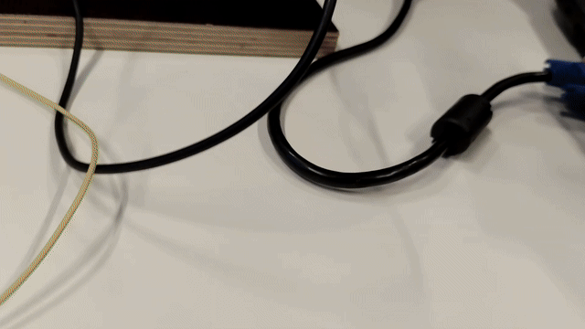

# Two-Arm Robot Positioning with a Raspberry Pi Pico

*To find out what the directories are about, please refer to the **Directories_Guidance.md** file.*

*For a detailed explanation, please refer to project-report.pdf.*

*Thanks to Professor **Samuel E. de Lucena** for mentoring me in this project.*

***

A digital PID position controller for a two-axis robotic arm driven by DC servo motors, running on a Raspberry Pi Pico (RP2040).

This started as a university project (Project B, HKA – Hochschule Karlsruhe, summer semester 2025). The goal was to build a small but realistic motion-control example: not only reaching a target angle accurately, but also behaving sensibly when something goes wrong, such as a broken wire, an emergency stop, or a mechanical collision.

Along the way the project also covered:

- Implementing and testing a hardware and software watchdog.
- Comparing hardware and software filtering of the encoder signals.
- Non-blocking, state-machine style programming, which is common in motion control (for example in CNC systems). Here it is applied to, and tested on, the zero (home) search.

## Overview

The Pico reads a quadrature encoder on each motor, runs a PID loop for each axis, and drives the motors through PWM and direction pins. A PC sends commands over USB serial, in a style similar to simple G-code.

```
PC (serial terminal)/potentiometer(manual mode) ──USB──> Raspberry Pi Pico ──> motor drivers ──> 2 × DC motors
                                                            ▲                                      │
                                                            └── encoders, zero switches, emergency input
```

Both motors are handled by a single RP2040 core, and there is still headroom for more axes. The code is built around a `motor` class, so additional motor objects can be created from the same class. Only two motors have been tested so far. The same code can be applied to other industrial MCUs that reserve specific quadrant encoder input ports.


*Picture by Professor Samuel E. de Lucena*

Note: The joystick in this figure could not be provided, hence it was substituted with two potentiometers.

## Features

- **Closed-loop position control** of two DC motors with incremental quadrature encoders (angle range 0–360°).
- **Two PID implementations**, selectable in `motor_config.h`. Two types of PID format were applied and tested:
  - Classic position-form PID based on the Arduino PID library, with output limiting, integral wind-up protection and derivative-on-measurement to avoid derivative kick.
  - A velocity-form PID (`PID_vel.*`), which is bumpless and does not wind up.

  More information: project-report.pdf
- **Three operating modes** via serial commands: manual, parallel (both axes move at once) and sequential (axis 2 starts after axis 1 arrives).
- **Zero (home) search** at startup using a switch on each axis. The encoder count is reset to 0° at the switch. A non-blocking state-machine version is available.
- **Encoder noise handling**: a small hardware capacitor filter plus a timing-based software filter that ignores interrupts arriving faster than physically possible, with a separate threshold per motor. The capacitor filter is good enough that the system can work perfectly with the software filter bypassed.
- **Safety logic**:
  - Fail-safe emergency input, where a broken wire is read as an emergency.
  - Zero switch reused as a collision/limit switch during normal operation.
  - Hardware watchdog plus a software loop watchdog.
  - After an emergency or collision, the system requires a new zero search before it moves again.
- **Configurable build** through compile-time switches (PID type, zero-search method, encoder filter, debug output).

Pin assignments are in the `motor` constructor calls in `main.cpp` / the `.ino` file. The emergency input is on GPIO 4.

## Software

- C++ with the Arduino framework (earlephilhower Pico core)
- Developed with **Arduino IDE** and **PlatformIO** (VS Code)
- [Arduino PID Library](https://github.com/br3ttb/Arduino-PID-Library) by Brett Beauregard (`br3ttb/PID` in PlatformIO)
- Serial monitor at **115200 baud**

### Project structure

```
DcServoControl/
├── include/
│   ├── motor.h
│   ├── motor_config.h        # PID values, timing, feature switches
│   ├── PID_vel.h
│   ├── zero_calibration.h
│   └── system_safety.h
└── src/
    ├── main.cpp              # setup, main loop, command parsing
    ├── motor.cpp             # motor class: encoder, PWM output, PID
    ├── PID_vel.cpp           # velocity-form PID
    ├── zero_calibration.cpp  # zero search / homing
    └── system_safety.cpp     # emergency handling, watchdogs
```

In the Arduino IDE layout, the same files sit next to the main `.ino` file.

### Build and upload (PlatformIO)

Example `platformio.ini`:

```ini
[env:pico]
platform = https://github.com/maxgerhardt/platform-raspberrypi.git
board = pico
framework = arduino
board_build.core = earlephilhower
upload_port = COM5        ; adjust to your port
monitor_port = COM5
monitor_speed = 115200
monitor_filters = send_on_enter
monitor_echo = yes
lib_deps = br3ttb/PID@^1.2.1
```

In the Arduino IDE, install the Pico board package and the PID library manually. The report found PlatformIO's serial monitor slightly less reliable than the Arduino IDE's, so try the other one if you hit odd serial behaviour.

## Usage

1. Power on. The Pico runs the zero search, then prints `System ready.`
2. Send commands over the serial terminal:

| Command | Description |
|---|---|
| `M` | Manual mode (the manual-control code is a placeholder in the current version) |
| `P a1 a2` | Parallel move: both motors go to angles `a1`, `a2` |
| `S a1 a2` | Sequential move: motor 1 first, then motor 2 |

Example: `P 30 60`. Setpoints are limited to 0–360°.

3. The terminal prints setpoints, current positions and PID parameters while moving.
4. If an emergency or collision occurs, the motors stop. Clear the cause, and the system will re-run the zero search before accepting new moves.

## Configuration

Key options in `motor_config.h`:

- `USE_CLASSICAL_PID`: 1 = classic PID, 0 = velocity PID
- `USE_ZERO_NON_BLOCKING`: non-blocking zero search
- `USE_ENCODER_FILTER`: enable the software encoder filter
- `DEBUG_SERIAL`: serial debug output
- Watchdog timeouts, motor dead band, maximum speed, and per-motor encoder filter times

Default classic PID values found by tuning: `Kp = 5.0`, `Ki = 0`, `Kd = 0.25`, sample time 10 ms. Treat these as a starting point for this particular hardware, not universal values.

## Lessons learned

Reliable encoder counting turned out to be harder than the PID loop. Inconsistent, non-repeatable motion was traced to noise and slightly uneven pulse timing on the encoder signals. The final setup uses a single 392 pF capacitor per channel plus a software time filter (50 µs for motor 1, 20 µs for motor 2). Both values were found largely by trial and error, so expect to retune them on different hardware. A Schmitt-trigger buffer such as the 74HC14 is a cleaner option worth trying.

## Limitations

- Only tested with two motors; scaling to more axes is untested.
- Manual mode was implemented successfully in a previous version and removed from the final version, in order to focus on other areas.
- The emergency input is polled, not interrupt-driven, so reaction time depends on loop speed.
- The zero switch has two different applications: at start-up it acts as the zero switch, and afterwards it acts as the limit switch. Real systems should have separate limit switches at each end of travel.
- The hardware encoder filter is sensitive: deviations of about ±50 pF stopped it working properly.
- Encoder signals are not ideal quadrature and differ between the two motors, so filter values are motor-specific.
- Backlash is not compensated.
- Tuning was done manually, with no automatic tuning or full performance characterisation.

## Possible improvements

- Add an interrupt-based emergency input alongside polling.
- Separate limit switches and homing switches, wired as normally-closed.
- Hand-wheel jogging with an encoder, feed and axis selectors, instead of a potentiometer.
- Automatic or more systematic PID tuning.
- Anti-bounce or settling logic for the velocity PID to reduce vibration.
- A PC-side GUI for control and live plotting.
- Backlash compensation.
- A Schmitt-trigger input stage for cleaner encoder signals.
- Testing with higher-power motors, with extra care on the safety side.

⚖️ **Important**: It is worth googling *Interpolation (Trajectory Generation)* and developing this project further.


### 🎥 Robot Demonstration

The following demonstration shows the robot performing the reference-zero search:



## Author

Peiman Edalatjoo, HKA – Hochschule Karlsruhe, Summer 2025.

***

Any feedback or development report is appreciated: **peiman.edalatjoo@proton.me** or **edpe1011@h-ka.de**

***
